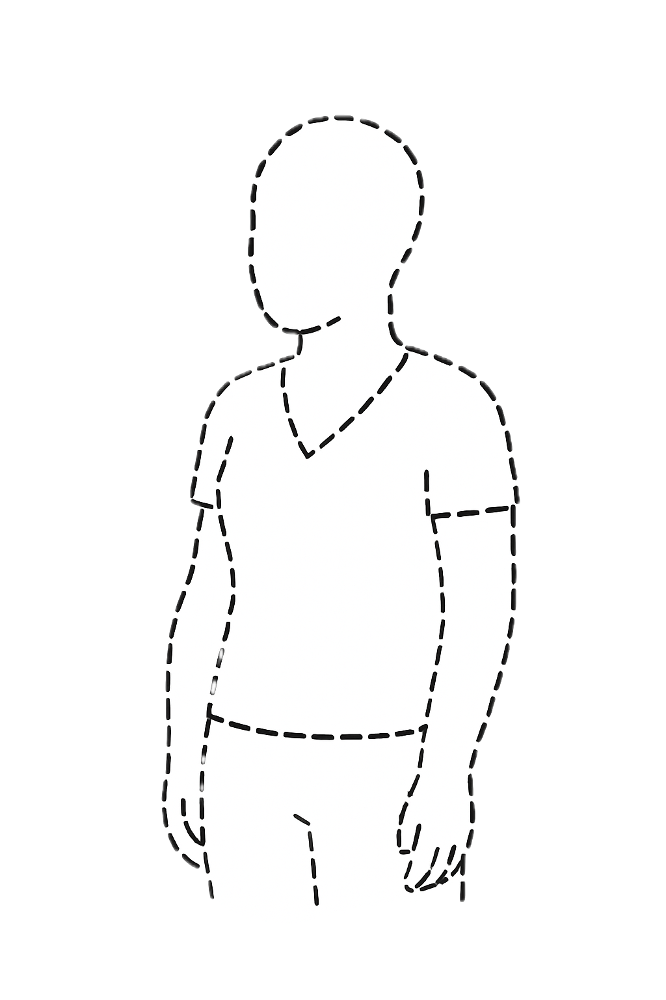

<section class="hero container">
  

    
For Apple Watch workoutsMade in Tahiti

    <h1>Your watch records. Horo explains.</h1>
    
A pace, a heart rate, a list of numbers. What do they mean for your training? Horo turns your Apple Health workouts into clear feedback and a focus for your next session.

    
<a class="btn btn-primary" href="{{ site.app_store_url }}">Download free on the App Store</a><a class="btn btn-secondary" href="#example">See an example</a>

    
Free plan available · iOS / iPadOS 26 or later · English &amp; French

    <a class="text-link" href="get-started.html">Already installed? Get your first analysis →</a>
  

  <aside class="example-card" id="example" aria-label="Illustrative coaching example">
    
Illustrative exampleRunning

    <h2>Beyond pace and distance.</h2>
    

<strong>5.0 <small>km</small></strong>Distance

<strong>30:00</strong>Duration

<strong>6:00 <small>/km</small></strong>Pace

    

<strong>The question behind the numbers</strong>
“Was this the easy run I intended?”

    
Horo uses the available workout metrics and your profile to give you a coach’s perspective. A number alone does not tell the whole story.

    
Example data, not an app screenshot or a real analysis. Feedback depends on the data available.

  </aside>
</section>

<section class="container" id="how-it-works">
  <h2 class="section-title">Start with a workout you already recorded.</h2>
  
No need to change how you record your training.

  

<article class="card">01<h3>Connect Apple Health</h3>
Allow Horo to read your workouts and the metrics you want to share.
</article>
<article class="card">02<h3>Open a recent workout</h3>
Choose your coach and open a session to get your feedback. An internet connection is needed for analysis.
</article>
<article class="card">03<h3>Take one idea into your next session</h3>
Read the feedback, choose one useful point, then return after your next workout.
</article>

<a class="text-link" href="get-started.html">Follow the getting-started guide →</a>

</section>
<section class="container">
<h2 class="section-title">Start with your next run. Bring your other sports too.</h2>

<article class="card"><h3>Running</h3>
Pace, heart rate, cadence: put the available metrics into the context of your session.
</article>
<article class="card"><h3>Cycling</h3>
Go beyond distance with heart rate and power metrics when your recording includes them.
</article>
<article class="card"><h3>Swimming</h3>
Explore your pace, stroke count and SWOLF when available in Apple Health.
</article>

Walking and other workout types are also supported. Available metrics depend on your device, recording app and permissions.
</section>
<section class="container fade-in">
  <h2 class="section-title">Meet the coaches</h2>
  
Choose the coaching personality that fits you best. The fourth slot is a seasonal mystery coach.

  

    

      <article class="coach-card">
        Core Coach
        
        <h3>Harmonie</h3>
        
Holistic coach focused on balance, energy and sustainable progress.

      </article>
      <article class="coach-card">
        Core Coach
        
        <h3>Carl</h3>
        
Data-driven analyst who translates metrics into precise action.

      </article>
      <article class="coach-card">
        Core Coach
        
        <h3>Sarge Kruger</h3>
        
High-discipline coach with direct feedback and a no-excuses tone.

      </article>
      <article class="coach-card">
        Seasonal Coach
        
        <h3>Mystery Coach</h3>
        
A limited-time seasonal personality with a unique style and tone.

      </article>
    

    

      <button class="carousel-btn" data-carousel-prev aria-label="Previous coach">←</button>
      <button class="carousel-btn" data-carousel-next aria-label="Next coach">→</button>
    

  

</section>
<section class="container">
  

    
After your next workout<h2 class="section-title">Make the debrief part of your routine.</h2>
Open Horo once your workout has synced to Apple Health. Read your coach’s feedback and ask yourself: what will I keep, and what will I try differently?

    <a class="btn btn-secondary" href="get-started.html#next-workout">Prepare your next visit</a>
  

</section>
<section class="container faq">
  <h2 class="section-title">Before you get started</h2>

Can I try Horo for free ?

Yes. There is a free plan with a daily analysis allowance. Your current allowance is shown in the app; Premium is optional.

Do I need an Apple Watch?

Horo reads workouts from Apple Health, including those recorded by Apple Watch and compatible apps. You need workouts saved in Apple Health, and an iPhone or iPad running version 26 or later.

What happens to my workout data?

Analysis sends workout metrics to our backend and OpenAI to generate feedback. Read our <a href="privacy-policy.html">privacy policy</a> before getting started.

Is this a training plan?

Horo gives feedback on recorded sessions. It is not a scheduled training plan or medical advice.

</section>
<section class="container">
<h2>Your last workout has more to tell you.</h2>
Try Horo with a session already in Apple Health. Start free and decide whether the feedback is useful to you.

<a class="btn btn-secondary" href="{{ site.app_store_url }}">Download free on the App Store</a><a class="btn btn-secondary" href="plans.html">Free vs Premium</a>

</section>
<section class="container founder-note"><h2>Help shape Horo</h2>
I’m Paraita, Horo’s independent developer in Tahiti. After your first analysis, tell me what helped, what was unclear, or what stopped you.
<a class="text-link" href="mailto:paraita@paraita.io?subject=Horo%20Coach%20feedback">Send Paraita feedback →</a></section>
